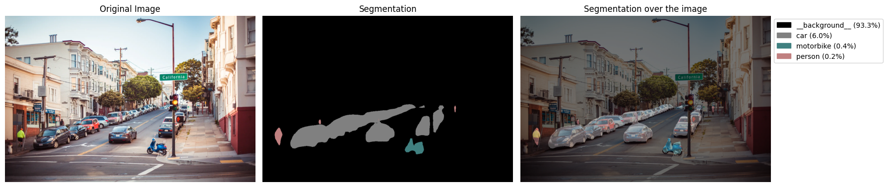
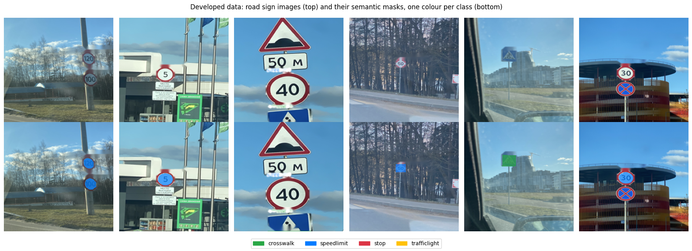
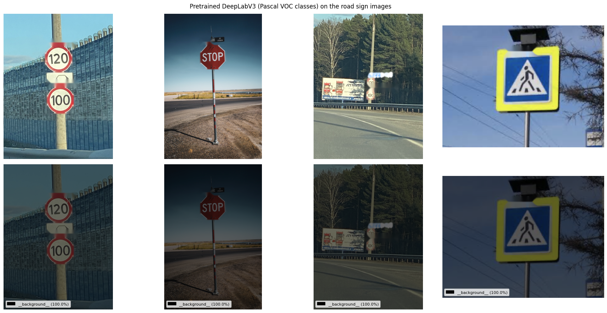
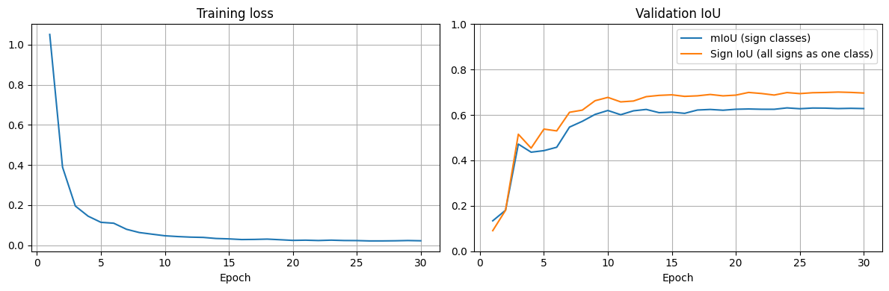
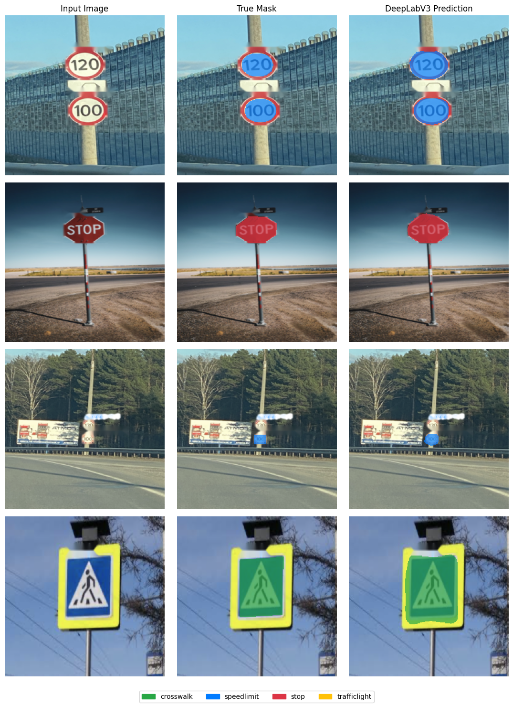
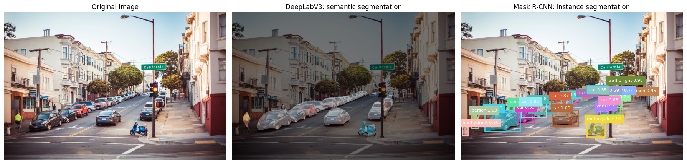
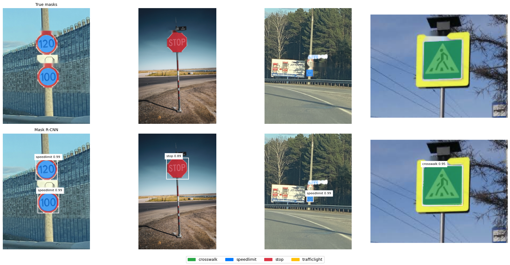
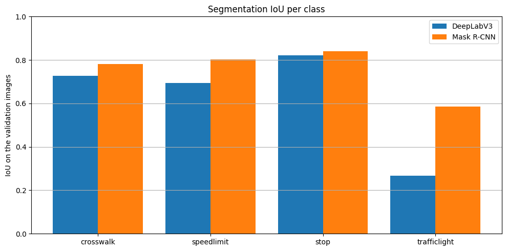

# Tutorial 11 – Semantic Segmentation using a Pretrained Model (DeepLabV3)

## Objective
Understand semantic segmentation and the architecture of DeepLabV3, use a pretrained DeepLabV3 to segment an image, and visualize the results. Then test a segmentation model on our own data and implement Mask R-CNN.

- **Semantic segmentation** gives every pixel a class (person, car, background...). All objects of the same class get the same label, so a row of parked cars becomes one "car" area.
- **DeepLabV3** uses a ResNet backbone with *atrous (dilated) convolutions*, which see a larger area of the image without shrinking the feature map, and an **ASPP** module (Atrous Spatial Pyramid Pooling) that looks at the image at several scales at once. Its prediction is upsampled back to the size of the input image.
- **Mask R-CNN** does *instance segmentation*: it is Faster R-CNN (Tutorial 8) with an extra branch that predicts a mask for each detected object, so every object gets its own box, class and exact outline.

The tutorial is written in **PyTorch** with `torchvision`, as in the tutorial itself.

## Files
| File | Description |
|---|---|
| `Tutorial_11.py` | Complete code, split into numbered blocks |
| `Tutorial_11_Colab.ipynb` | The same code as a Colab notebook, with outputs |
| `*.png` | Output images and plots |

## Tutorial Steps
DeepLabV3 with a ResNet-101 backbone (60,996,202 parameters), pretrained on COCO images labelled with the 21 Pascal VOC classes (20 classes + background), was loaded, and a photo of a San Francisco street intersection was normalized and segmented. Every pixel's class (the one with the highest score) was coloured with the Pascal VOC palette. In newer versions of torchvision, `pretrained=True` has been replaced by `weights=DeepLabV3_ResNet101_Weights.DEFAULT`.

| Class found | Share of the pixels |
|---|---|
| background | 93.3% |
| car | 6.0% |
| motorbike | 0.4% |
| person | 0.2% |

The model correctly found the parked and moving cars, the scooter and the pedestrians. All cars are painted in the same colour, because semantic segmentation does not separate objects of the same class. The traffic light and the fire hydrant are labelled as background, because they are not among the 21 Pascal VOC classes.

## Task 1 – Test a model on the developed data
The developed data is the same 150 road sign images as Tutorials 8–10, with the same 119/30 train/validation split. As in Tutorial 10, each labelled box was turned into a sign-shaped mask with GrabCut (113 signs) or kept as a full box when it was too small (80 signs), but this time every sign type is its own class:

| Class | Share of the training pixels |
|---|---|
| background | 96.89% |
| crosswalk | 0.87% |
| speedlimit | 1.31% |
| stop | 0.66% |
| trafficlight | 0.27% |

**Pretrained DeepLabV3 as it is:** on the road sign images, it labelled **100% of the pixels as background**. Its 21 Pascal VOC classes do not include road signs, so a pretrained model cannot be used on new kinds of objects without further training.

**Fine-tuned DeepLabV3 (ResNet-50 backbone):** the pretrained model was given a new last layer for the 5 classes and trained for 30 epochs (801 s). To solve the problem seen in Tutorial 10, where the U-Nets predicted "no sign" everywhere for many epochs, the loss gave more weight to the rare sign pixels (weights from 8.6 for speedlimit to 18.9 for trafficlight, compared with 1 for background). The model already reached a sign IoU of 0.54 after 5 epochs.

| Class | IoU |
|---|---|
| background | 0.990 |
| crosswalk | 0.728 |
| speedlimit | 0.694 |
| stop | **0.823** |
| trafficlight | 0.268 |
| **mIoU (sign classes)** | **0.628** |
| **Sign IoU (all signs as one class)** | **0.697** |

The fine-tuned DeepLabV3 traced the shapes of the large signs well. Traffic lights were the hardest class (IoU 0.268): they cover only 0.27% of the pixels and are often only a few pixels wide in the 256×256 images.

## Task 2 – Implement Mask R-CNN
**Pretrained Mask R-CNN (ResNet-50 FPN, COCO) on the street photo:** it found **29 objects** with a score of at least 0.5: 23 cars, 3 people, a motorcycle, a traffic light and a fire hydrant. Unlike DeepLabV3, it gave **each car its own mask and colour**, which is the difference between instance and semantic segmentation. It also found the traffic light and the fire hydrant, because it was trained on all 80 COCO classes instead of the 20 Pascal VOC classes.

**Mask R-CNN trained on the developed data:** the pretrained model was given new box and mask predictors for the sign classes and trained for 15 epochs (560 s). The total loss fell from 0.960 to 0.143, and the mask loss from 0.455 to 0.087.

| Class | Mask IoU | Box AP@0.5 | Box AP@0.75 |
|---|---|---|---|
| background | 0.994 | – | – |
| crosswalk | 0.781 | 0.784 | 0.750 |
| speedlimit | 0.804 | 0.919 | 0.919 |
| stop | **0.841** | 0.750 | 0.750 |
| trafficlight | 0.587 | 0.587 | 0.167 |
| **Mean** | **mIoU 0.753** | **mAP 0.760** | **mAP 0.647** |

**Sign IoU (all signs as one class): 0.796.**

## Comparison
All models were scored on the same validation masks and images:

| Model | Sign IoU | mIoU (sign classes) | Train time (s) |
|---|---|---|---|
| U-Net from scratch (Tutorial 10, best) | 0.418 | – | 355 |
| DeepLabV3 ResNet-50 (fine-tuned) | 0.697 | 0.628 | 801 |
| **Mask R-CNN ResNet-50 FPN (fine-tuned)** | **0.796** | **0.753** | **560** |

- **Pretrained backbones made the biggest difference.** Both fine-tuned models were far better than the U-Net trained from scratch in Tutorial 10 (0.418), even with the same 119 training images, because they started with features already learned from COCO.
- **Mask R-CNN was the best segmentation model** and beat DeepLabV3 on every class. The biggest gap was on traffic lights (0.587 vs 0.268). Mask R-CNN first finds each object and then predicts its mask on a fixed-size crop of that object, so even a small traffic light gets a detailed mask. DeepLabV3 segments the whole 256×256 image at once, where a traffic light is only a few pixels wide. Mask R-CNN also worked on the full-size images.
- **Stop signs were the easiest class** for both models (0.823 and 0.841): they are large, red and have a unique shape.
- **Small, distant signs were still missed**, such as the small 120 sign in the third validation image.
- **Mask R-CNN's boxes reached mAP@0.5 = 0.760**, close to the Faster R-CNN of Tutorial 8 (0.806) on the same test images, while also giving the exact shape of each sign. YOLOv8n from Tutorial 9 is still the best box detector (0.904).
- **Pixel accuracy (0.9905 for DeepLabV3) says little here**, as seen in Tutorial 10: background is 97% of the pixels. IoU per class shows the real quality.
- With only 3 traffic lights and 4 stop signs in the validation images, the scores of these classes are uncertain.

## How to Run
In Google Colab, select **Runtime → Change runtime type → T4 GPU**, upload `Tutorial_11_Colab.ipynb` (File → Upload notebook) and run the cells in order. Block 3 asks for any photo, ideally with people, animals, vehicles or furniture. Block 7 asks for the zip of labelled images: the road sign zip from Tutorials 8–10, or images with polygon labels in COCO JSON format.

## Requirements
Python 3, PyTorch, torchvision, OpenCV, NumPy, Matplotlib, Pillow, PyYAML (all preinstalled in Google Colab)

## Output

### DeepLabV3 on a random image

### Task 1 – Developed data: road sign images and their masks

### Task 1 – Pretrained DeepLabV3 on the road sign images

### Task 1 – Fine-tuned DeepLabV3: training

### Task 1 – Fine-tuned DeepLabV3: predictions

### Task 2 – Semantic segmentation (DeepLabV3) vs instance segmentation (Mask R-CNN)

### Task 2 – Mask R-CNN trained on the road signs: predictions

### IoU per class: DeepLabV3 vs Mask R-CNN

