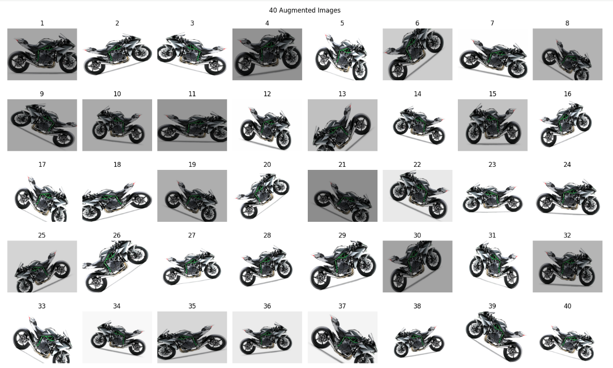

# Tutorial 4 – Data Augmentation

## Objective
Understand why data augmentation is needed in deep learning and how it works. When collecting thousands of images is not possible, augmentation creates new training images from existing ones by applying random transformations, which increases the size and variety of the dataset. This tutorial uses Keras `ImageDataGenerator` to do this.

## Files
| File / Folder | Description |
|---|---|
| `Tutorial_4.py` | Code for loading an image, augmenting it and saving the results |
| `original.jpg` | The original image used |
| `Augmented_Images/` | The 40 augmented images generated |

## Task
**Generate 40 augmented images from a single JPEG image.** One image was taken from the computer and passed through `ImageDataGenerator` with the following random transformations:

- Rotation of up to 40 degrees
- Shear of 0.2
- Zoom in or out by up to 20%
- Horizontal flip
- Brightness between 50% and 150%

The loop generates one new image at a time and stops after 40. All 40 images are saved in the `Augmented_Images` folder and displayed together in a grid.

## How to Run
Open Google Colab, upload `Tutorial_4.py` and run `%run Tutorial_4.py`. When asked, choose a JPEG image from your computer. The augmented images are shown on screen and downloaded as a zip file.

## Requirements
Python 3, TensorFlow, Matplotlib (all preinstalled in Google Colab)

## Output

