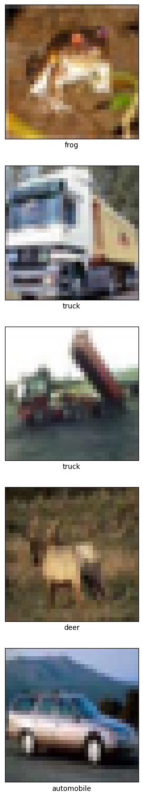
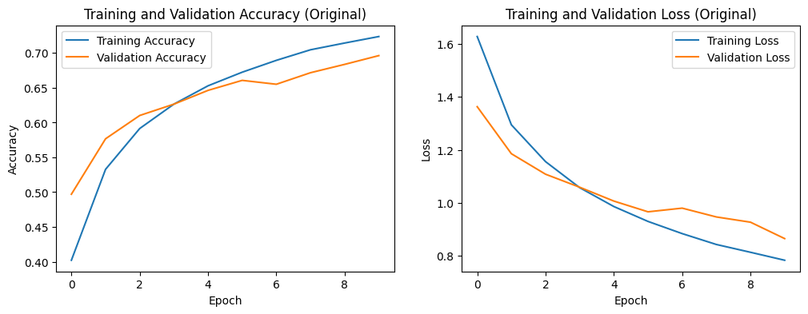
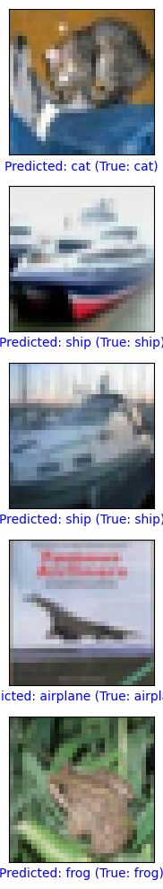
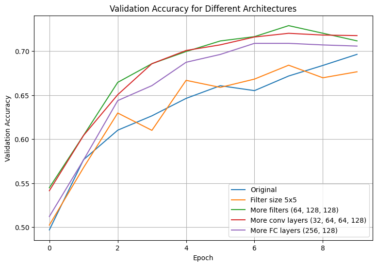
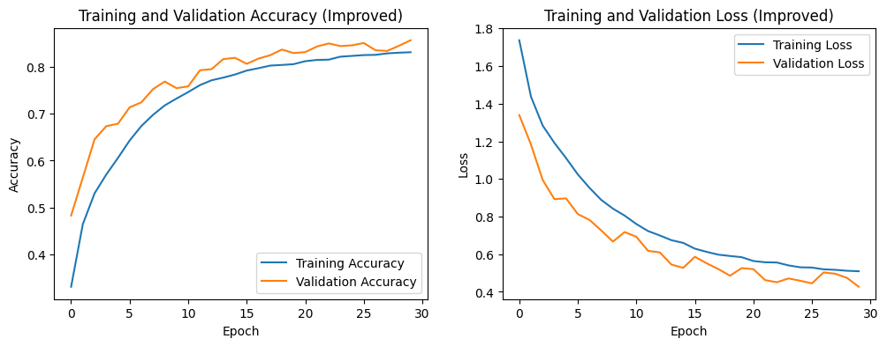

# Tutorial 5 – Convolutional Neural Network (CNN)

## Objective
Build, train and evaluate a Convolutional Neural Network that classifies the 10 classes of the CIFAR-10 dataset (airplane, automobile, bird, cat, deer, dog, frog, horse, ship, truck). The tutorial covers how convolution and pooling layers extract features from images, how to plot training and validation curves, and how to improve accuracy and reduce overfitting.

The tutorial was given in TensorFlow/Keras and has been implemented here in **PyTorch**. The original model is identical to the tutorial's: three convolution layers (32, 64, 64 filters), two max-pooling layers, a 64-neuron dense layer and a 10-class output, with 122,570 parameters in both versions.

## Files
| File | Description |
|---|---|
| `Tutorial_5.py` | Complete code, split into numbered blocks |
| `Tutorial_5_Colab.ipynb` | The same blocks as a Colab notebook, with outputs |
| `*.png` | Output plots |

## Tasks and Results

| Model | Parameters | Train acc | Test acc | Epochs | Time (s) |
|---|---|---|---|---|---|
| Original | 122,570 | 0.7237 | 0.6963 | 10 | 127 |
| Filter size 5×5 | 160,970 | 0.7413 | 0.6765 | 10 | 126 |
| More filters (64, 128, 128) | 355,018 | 0.8070 | 0.7116 | 10 | 125 |
| More conv layers (32, 64, 64, 128) | 261,962 | 0.8209 | 0.7176 | 10 | 131 |
| More FC layers (256, 128) | 352,906 | 0.7971 | 0.7057 | 10 | 129 |
| **Improved model** | 551,466 | 0.8306 | **0.8561** | 30 | 495 |

**Task 1 – Different architectures:** The original model was compared with four modified versions, each trained for 10 epochs. The 5×5 filter size performed worst (67.7%), because larger filters shrink the image faster and lose fine detail on small 32×32 images. More filters, an extra convolution layer and more dense layers all improved test accuracy slightly (70.6–71.8%), with the extra convolution layer giving the best result. However, all three raised training accuracy much more than test accuracy (about 80% vs 71%), and their validation loss started rising after epoch 8, which shows that simply making the network bigger leads to overfitting.

**Task 2 – Improving accuracy:** An improved model was built with two convolution layers per block, batch normalization, more filters (32 → 64 → 128), and data augmentation (random crops and horizontal flips) on the training images. Test accuracy increased from **69.6% to 85.6%**.

**Task 3 – Removing overfitting:** The larger Task 1 models showed clear overfitting: a gap of about 10% between training and test accuracy, and a rising validation loss. The improved model solves this with dropout after every block, weight decay (L2 regularization), data augmentation and early stopping. Its validation accuracy stays slightly above training accuracy and both losses keep decreasing together, so the model is well-fitted. Validation is higher than training here because dropout and augmentation are only active during training. Early stopping was not triggered in 30 epochs, as the validation loss was still improving.

## How to Run
In Google Colab, select **Runtime → Change runtime type → T4 GPU**, then either upload `Tutorial_5_Colab.ipynb` (File → Upload notebook) and run all cells, or paste each block of `Tutorial_5.py` into its own cell.

## Requirements
Python 3, PyTorch, torchvision, NumPy, Matplotlib (all preinstalled in Google Colab)

## Output

### Sample CIFAR-10 images

### Original model

### Task 1 – Validation accuracy for different architectures

### Improved model

