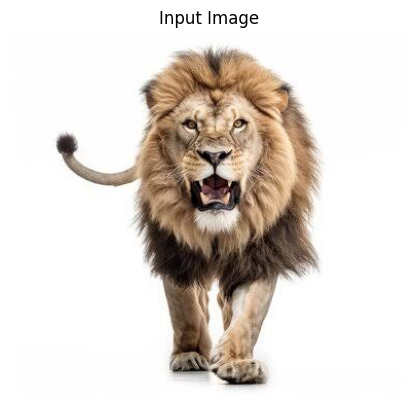
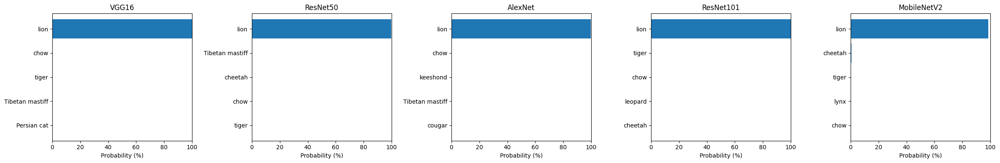
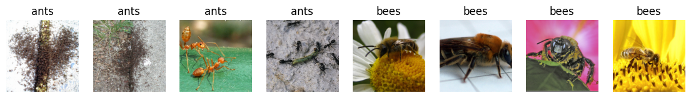
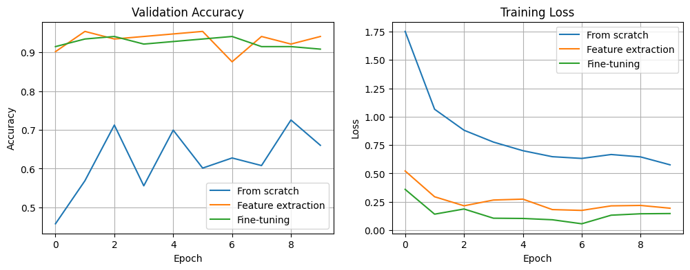
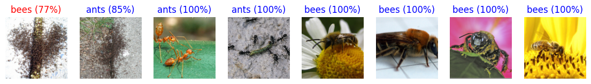

# Tutorial 6 – Transfer Learning: Predicting with Pretrained Models

## Objective
Use deep networks that have already been trained on ImageNet (1.2 million images, 1000 classes) to classify a new image without any training, and print the top 5 predicted labels with their probabilities. Then use transfer learning to adapt a pretrained model to a new dataset.

The tutorial was given in TensorFlow/Keras and has been implemented here in **PyTorch** using `torchvision.models`. One difference: in Keras, VGG16 and ResNet50 each need their own `preprocess_input` function, while in PyTorch all ImageNet models use the same preprocessing (resize to 256, center crop to 224, normalize with the ImageNet mean and standard deviation).

## Files
| File | Description |
|---|---|
| `Tutorial_6.py` | Complete code, split into numbered blocks |
| `Tutorial_6_Colab.ipynb` | The same blocks as a Colab notebook, with outputs |
| `*.png` | Output images and plots |

## Tasks and Results

**Task 1 – PyTorch:** The whole tutorial and all tasks are written in PyTorch. A photo of a lion was used as the test image. VGG16 predicted **lion (99.98%)** and ResNet50 predicted **lion (99.87%)**. Their lower guesses were also sensible, such as tiger, cheetah, and dog breeds with lion-like manes (chow, Tibetan mastiff).

**Task 2 – Different architectures:** AlexNet, ResNet101 and MobileNetV2 were added and all five models were compared on the same image.

| Model | Parameters | Top-1 prediction | Confidence | Inference time (ms) |
|---|---|---|---|---|
| VGG16 | 138,357,544 | lion | 99.98% | 20.69 |
| ResNet50 | 25,557,032 | lion | 99.87% | 5.93 |
| AlexNet | 61,100,840 | lion | 99.71% | 1.87 |
| ResNet101 | 44,549,160 | lion | 99.97% | 11.09 |
| MobileNetV2 | 3,504,872 | lion | 98.68% | 4.89 |

All five models correctly identified the lion with over 98% confidence, so a clear image of a common animal is easy for every ImageNet model. The differences are in size and speed. VGG16 is the largest and slowest model, while MobileNetV2 reached almost the same confidence with about 40 times fewer parameters, which is why it is designed for mobile devices. AlexNet was the fastest because it is a shallow network with only 8 layers. ResNet50 gave the best balance of size, speed and accuracy.

**Task 3 – Transfer learning on a dataset:** The Ants vs Bees dataset (244 training and 153 validation images) was used to train ResNet50 in three ways for 10 epochs each.

| Approach | Trainable parameters | Best val acc | Final val acc | Time (s) |
|---|---|---|---|---|
| From scratch | 23,512,130 | 0.7255 | 0.6601 | 41.3 |
| Feature extraction | 4,098 | **0.9542** | **0.9412** | 24.9 |
| Fine-tuning | 23,512,130 | 0.9412 | 0.9085 | 41.0 |

- **From scratch:** random weights, all layers trained. With only 244 images, the model could not learn useful features and reached only 66–73% accuracy, close to guessing.
- **Feature extraction:** pretrained weights frozen, only a new final layer trained. This gave the best result (94–95%) while training only 4,098 parameters, and it was the fastest.
- **Fine-tuning:** all layers trained from the pretrained weights with a small learning rate. It reached 96% training accuracy, but validation loss started rising, so it slightly overfitted the small dataset and ended at 91%.

Using a pretrained model improved accuracy by almost 30% compared with training from scratch. For a very small dataset, freezing the pretrained layers works best, because the features learned from ImageNet are already good and there is too little data to safely retrain 23 million parameters. On the sample validation images, the fine-tuned model classified 7 out of 8 correctly; the one mistake was a blurry swarm of ants with no clear single insect.

## How to Run
In Google Colab, select **Runtime → Change runtime type → T4 GPU**, upload `Tutorial_6_Colab.ipynb` (File → Upload notebook) and run the cells in order. Block 5 asks you to upload an image from your computer.

## Requirements
Python 3, PyTorch, torchvision, NumPy, Matplotlib, Pillow (all preinstalled in Google Colab)

## Output

### Input image

### Task 2 – Top 5 predictions from all five models

### Task 3 – Ants vs Bees dataset

