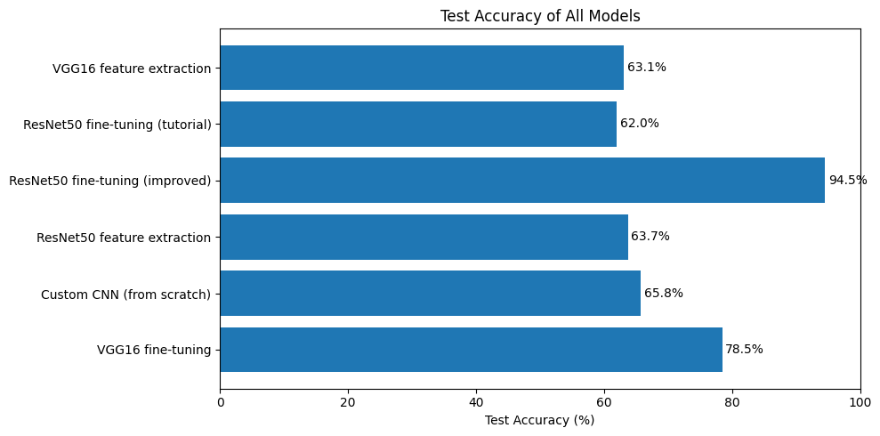
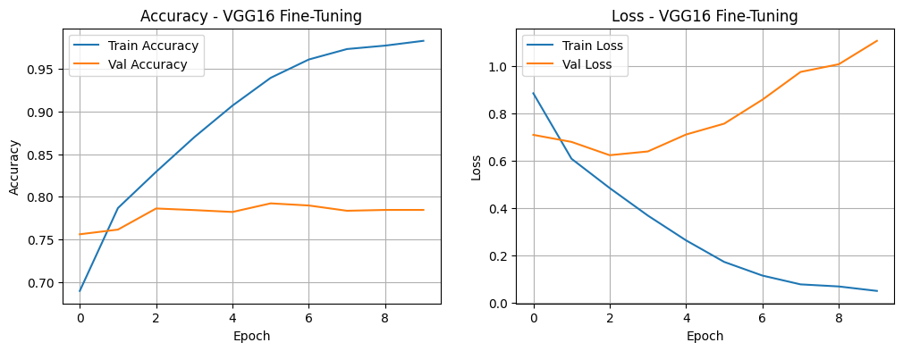
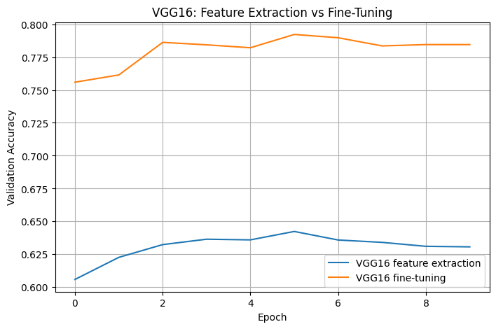

# Tutorial 7 – Feature Extraction vs Fine-Tuning

## Objective
Compare the two main ways of using a pretrained model on a new dataset (CIFAR-10):

- **Feature extraction:** all pretrained layers are frozen and only new classification layers are trained.
- **Fine-tuning:** some of the pretrained layers are unfrozen and retrained together with the new layers, usually with a small learning rate.

The tutorial was given in TensorFlow/Keras and has been implemented here in **PyTorch**, following the same steps: VGG16 for feature extraction, and ResNet50 with the last 5 layers unfrozen and a learning rate of 1e-5 for fine-tuning. Both use the tutorial's new classification layers (Flatten → Dense 512 → Dense 10).

## Files
| File | Description |
|---|---|
| `Tutorial_7.py` | Complete code, split into numbered blocks |
| `Tutorial_7_Colab.ipynb` | The same blocks as a Colab notebook, with outputs |
| `*.png` | Output plots |

## Results

| Model | Trainable parameters | Test accuracy | Epochs | Time (s) |
|---|---|---|---|---|
| VGG16 feature extraction (tutorial) | 267,786 | 63.07% | 10 | 127 |
| ResNet50 fine-tuning (tutorial) | 2,106,890 | 62.00% | 10 | 195 |
| **ResNet50 fine-tuning (improved)** | 23,117,322 | **94.53%** | 5 | 286 |
| ResNet50 feature extraction | 1,054,218 | 63.70% | 10 | 186 |
| Custom CNN (from scratch) | 122,570 | 65.75% | 10 | 119 |
| VGG16 fine-tuning | 7,347,210 | 78.45% | 10 | 137 |

## Tasks

**Task 1 – PyTorch:** The whole tutorial and all tasks are written in PyTorch. Following the tutorial exactly, VGG16 feature extraction reached **63.07%** and ResNet50 fine-tuning reached **62.00%**.

The VGG16 feature extraction model overfitted: training accuracy rose to 83% while validation accuracy stopped at about 63%, and validation loss started increasing after epoch 4. The tutorial's ResNet50 fine-tuning had the opposite problem. With a learning rate of only 1e-5, it learned very slowly and was still improving after 10 epochs, so it was underfitting.

**Task 2 – Improving the fine-tuning results:** The ResNet50 fine-tuning was improved using the hints:
- **Preprocessing:** ImageNet normalization, and resizing the 32×32 images to 128×128 so they are closer to the size ResNet50 was trained on.
- **Preventing overfitting:** data augmentation (random crops and horizontal flips), dropout and weight decay.
- **Unfreezing more layers:** the whole of `layer3` and `layer4` instead of only the last 5 layers.
- **Learning rate:** 1e-4 for the pretrained layers and 1e-3 for the new layers, instead of 1e-5 for everything.
- **Early stopping and number of epochs:** up to 12 epochs, stopping when the validation loss stops improving.

Accuracy jumped from **62.00% to 94.53%**. The model reached 93.5% after the first epoch, and early stopping ended training at epoch 5 and kept the weights from epoch 2, which had the lowest validation loss. The biggest single improvement came from resizing the images: at 32×32, ResNet50 shrinks each image to a 1×1 feature map, so most of what it learned on ImageNet cannot be used.

**Task 3 – Feature extraction with ResNet50 vs custom model vs VGG16:** ResNet50 feature extraction (63.70%) was only slightly better than VGG16 feature extraction (63.07%), and both were beaten by the small custom CNN trained from scratch (65.75%), even though the custom CNN has far fewer parameters. With tiny 32×32 images and no ImageNet normalization, frozen ImageNet features do not fit CIFAR-10 well, so feature extraction alone gives little benefit here. Both feature extraction models also overfitted, as their small trainable heads memorized the training data while validation loss increased.

**Task 4 – Fine-tuning with VGG16 and feature extraction with ResNet50:** Fine-tuning the last convolution block of VGG16 improved its accuracy from **63.07% to 78.45%**, because the unfrozen layers could adapt their features to CIFAR-10. However, it overfitted strongly: training accuracy reached 98% while validation loss started rising after epoch 3. Early stopping and data augmentation, as used in the improved ResNet50 model, would help here. Feature extraction with ResNet50 is covered in Task 3.

**Conclusion:** Fine-tuning beat feature extraction in every comparison, but only when it was set up properly. The tutorial's fine-tuning settings were too cautious to help, while the improved setup reached 94.5%, the best result of all models.

## How to Run
In Google Colab, select **Runtime → Change runtime type → T4 GPU**, upload `Tutorial_7_Colab.ipynb` (File → Upload notebook) and run all cells.

## Requirements
Python 3, PyTorch, torchvision, NumPy, Matplotlib (all preinstalled in Google Colab)

## Output

### Test accuracy of all models

### VGG16 fine-tuning

