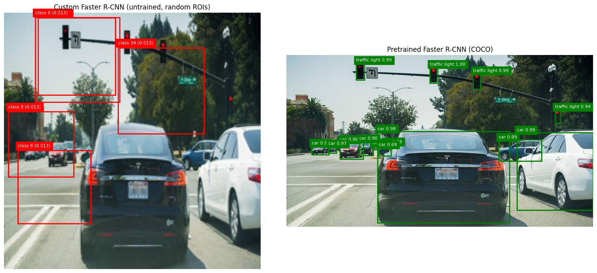
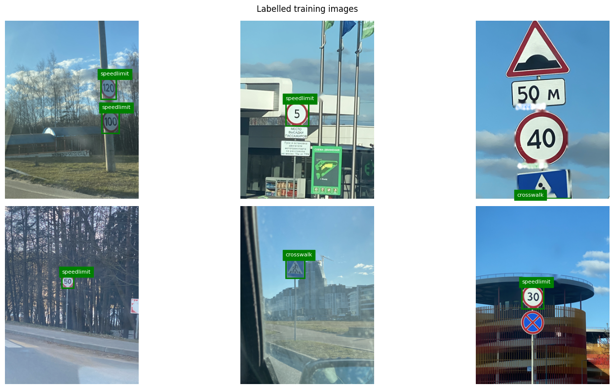
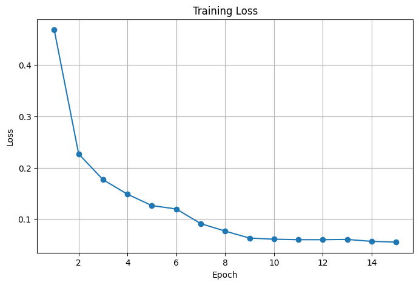
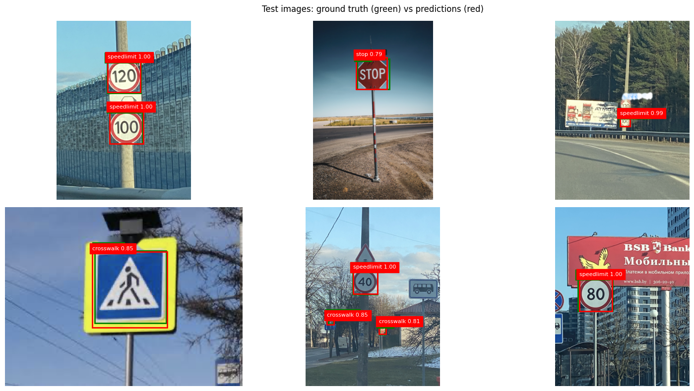

# Tutorial 8 – Object Detection with a Custom Faster R-CNN

## Objective
Understand how the Faster R-CNN object detector works by building one from its parts: a CNN backbone that extracts features, a Region Proposal Network (RPN) that suggests where objects might be, ROI pooling that turns each region into a fixed-size feature map, and heads that classify each region and refine its bounding box. The tutorial also covers how detectors are evaluated with Intersection over Union (IoU), precision, recall and mean Average Precision (mAP), and finishes by training and testing a detector on a self-labelled dataset.

The tutorial was given in TensorFlow/Keras and has been implemented here in **PyTorch**.

## Files
| File | Description |
|---|---|
| `Tutorial_8.py` | Complete code, split into numbered blocks |
| `Tutorial_8_Colab.ipynb` | The same code as a Colab notebook, with outputs |
| `*.png` | Output images and plots |

## The Custom Model
The model has the same layers as the tutorial's. A 4-layer backbone turns a 224×224 image into a 28×28×512 feature map, the RPN predicts objectness scores and box adjustments for 9 anchors at each position, ROI pooling gives a 7×7×512 map per region (using `torchvision.ops.roi_align`, the PyTorch equivalent of `tf.image.crop_and_resize`), and the heads output class probabilities and box values for 80 classes. The model has 30,039,622 parameters, 26.1 million of them in the heads.

The tutorial's mAP functions were implemented as given. The sample values give **mAP = 0.03**, even though both predictions are correct (the class 1 boxes overlap with an IoU of 0.77). This is because `num_classes = 80`, so the 77 classes with no objects each get an AP of 0 and pull the average down. Averaging only over the classes that appear (`num_classes = 3`) gives **mAP = 1.00**.

## Task 1 – Change the number of layers

| Backbone | Backbone params | Total params | Feature map | Anchors | Time (ms) |
|---|---|---|---|---|---|
| 3 conv layers | 665,984 | 29,154,630 | 56×56 | 28,224 | 7.95 |
| **4 conv layers (original)** | 1,550,976 | 30,039,622 | 28×28 | 7,056 | 5.46 |
| 5 conv layers | 3,910,784 | 32,399,430 | 14×14 | 1,764 | 4.91 |
| 6 conv layers | 6,270,592 | 34,759,238 | 7×7 | 441 | 5.32 |

Each extra convolution layer comes with a pooling layer, which halves the feature map in each direction and cuts the number of anchors by 4 (from 28,224 down to 441). Deeper backbones see a larger area of the image per feature and learn more complex features, but their coarse feature maps make small objects harder to locate. The shallow backbone keeps fine detail, but its large feature map gives the RPN 4 times more positions to process, which made it the slowest. The total number of parameters changes much less than the backbone, because most parameters are in the heads, whose size is fixed by the 7×7×512 ROI output.

## Task 2 – Test on an image
A street photo was passed through the untrained custom model and, for comparison, through a Faster R-CNN pretrained on COCO.

- **Untrained custom model:** the average objectness score was **0.497** and every class probability was about **0.013**, which is almost exactly 1/80. The model is guessing at random, and the classes it picked (8 and 34) mean nothing.
- **Pretrained Faster R-CNN:** it found **10 cars and 4 traffic lights**, with confidences from 0.69 to 1.00.

This shows that the architecture alone cannot detect anything. All of a detector's ability comes from training.

## Task 3 – Label about 150 images, then train and test a model
**Dataset:** 150 road sign images labelled with four classes. The labelled boxes are drawn on the images in one colour per class, so the code reads the box coordinates back from these colours and then paints the drawings out (inpainting), so the model learns from clean pictures. 149 images were used (1 had no labels), containing 193 objects: speedlimit (123), crosswalk (34), trafficlight (19) and stop (17).

The images were split into **119 for training and 30 for testing**. A Faster R-CNN (ResNet50 + FPN, pretrained on COCO) was given a new classifier for the four road sign classes and trained for 15 epochs (510.7 s on a T4 GPU). The training loss fell from 0.469 to 0.055 and levelled off after epoch 9, once the learning rate was reduced.

| Class | Train objects | Test objects | AP@0.5 | AP@0.75 | Precision | Recall |
|---|---|---|---|---|---|---|
| speedlimit | 101 | 22 | **0.976** | **0.939** | 0.875 | 0.955 |
| crosswalk | 26 | 8 | 0.829 | 0.732 | 0.636 | 0.875 |
| trafficlight | 16 | 3 | 0.733 | 0.500 | 0.333 | 0.333 |
| stop | 13 | 4 | 0.688 | 0.688 | 1.000 | 0.500 |
| **mAP** | | | **0.806** | **0.715** | | |

*Precision and recall are for detections with a score of at least 0.5.*

- **The model learned all four classes**, reaching **mAP@0.5 = 0.806** after training on only 119 images.
- **Speed limit signs were detected almost perfectly** (AP 0.976). They have by far the most training examples (101).
- **Stop signs and traffic lights scored lowest** because they had only 13 and 16 training examples. Their test sets are tiny (4 and 3 objects), so a single missed sign changes recall by 25–33%. More images of these classes would make the model more balanced.
- **mAP drops only from 0.806 to 0.715 at the stricter IoU of 0.75**, so most predicted boxes fit the signs tightly, as the test predictions figure shows.
- The custom model built above was not used for this task: it has no anchor generation, box decoding or training losses, and a randomly initialized detector cannot learn from 119 images. Fine-tuning a pretrained detector is the standard approach for a small dataset, as in Tutorials 6 and 7.

## How to Run
In Google Colab, select **Runtime → Change runtime type → T4 GPU**, upload `Tutorial_8_Colab.ipynb` (File → Upload notebook) and run the cells in order. Block 13 asks for any image, and Block 15 asks for the zip of labelled images (images with the boxes drawn on them, or images with Pascal VOC `.xml` / YOLO `.txt` label files).

## Requirements
Python 3, PyTorch, torchvision, OpenCV, NumPy, Matplotlib, Pillow, PyYAML (all preinstalled in Google Colab)

## Output

### Task 2 – Untrained custom model vs pretrained model

### Task 3 – Labelled training images

### Task 3 – Training loss

### Task 3 – Test images: ground truth (green) vs predictions (red)

