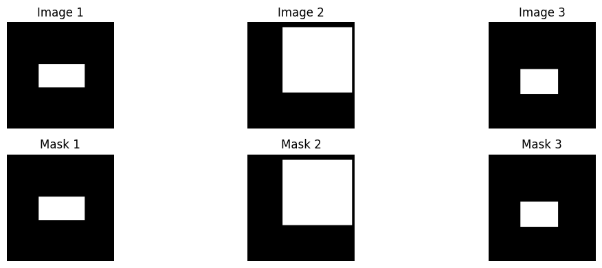
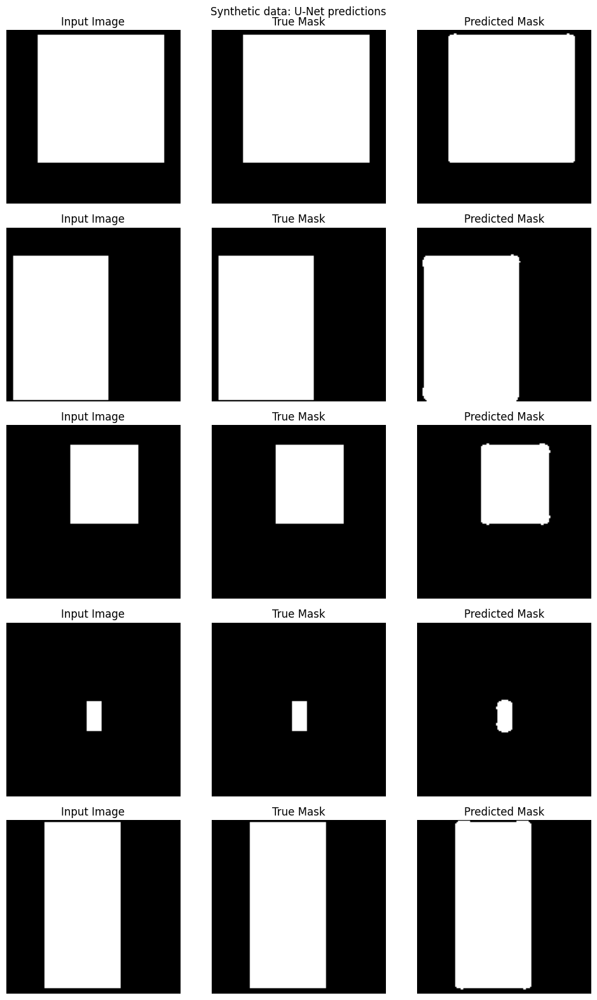
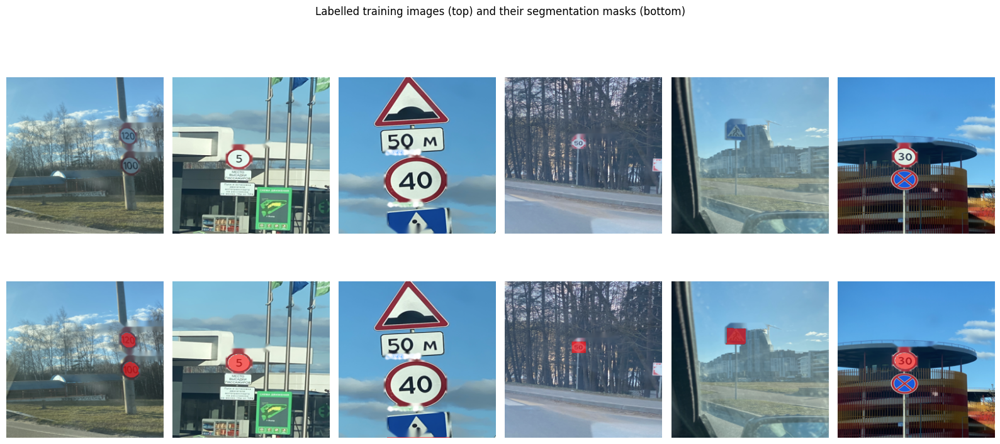
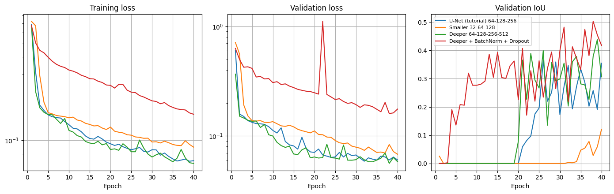
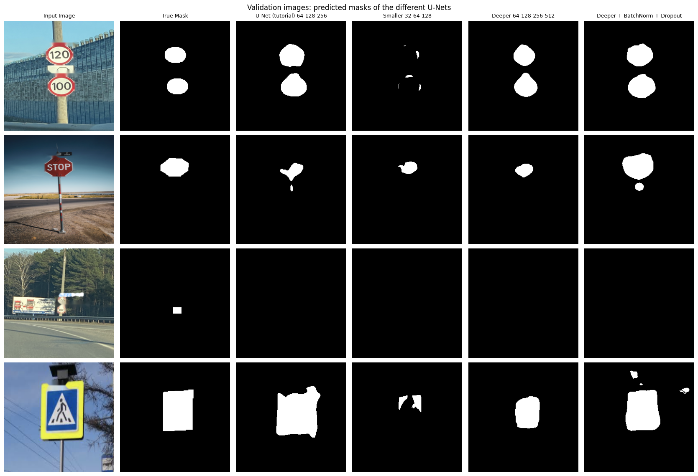
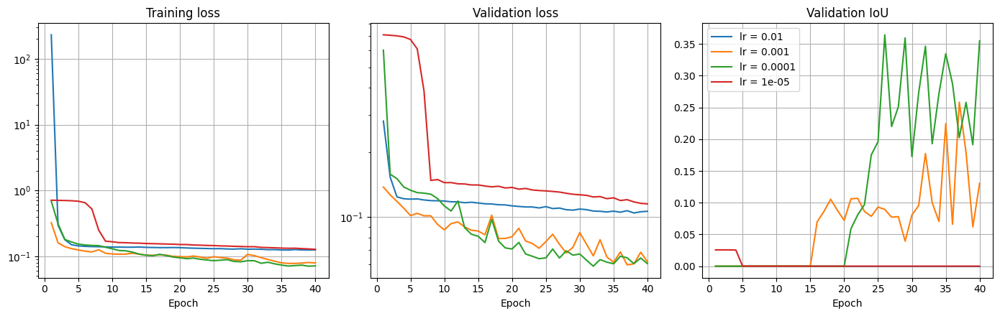
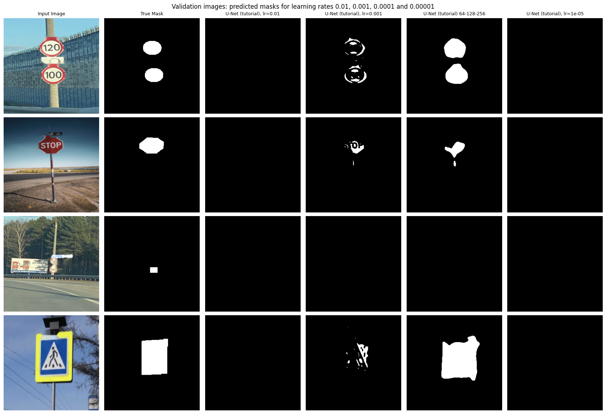
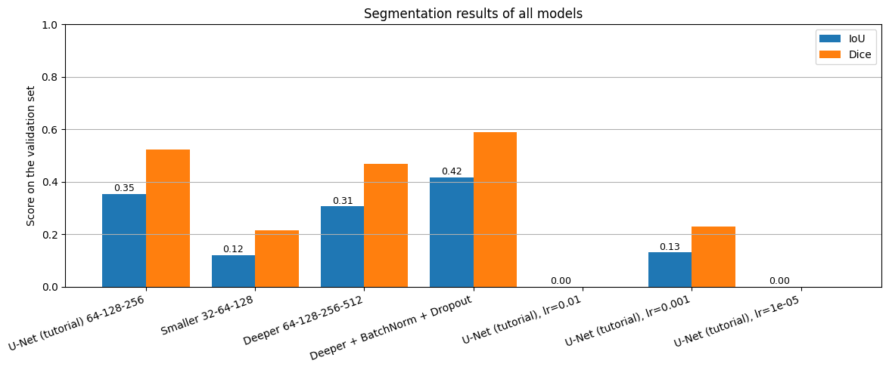

# Tutorial 10 – Segmentation using U-Net

## Objective
Understand the architecture of U-Net, implement it from scratch, and visualize its results. Unlike object detection, which draws a box around each object, **segmentation** classifies every pixel of the image, here as "object" or "background", so the output is a mask with the exact shape of each object.

**U-Net** has an encoder that shrinks the image and learns *what* is in it, a bottleneck, and a decoder that grows the feature maps back to the full image size to work out *where* it is. Skip connections copy each encoder output to the decoder level of the same size, so fine details lost by the pooling layers are recovered.

The tutorial was given in TensorFlow/Keras and has been implemented here in **PyTorch**.

## Files
| File | Description |
|---|---|
| `Tutorial_10.py` | Complete code, split into numbered blocks |
| `Tutorial_10_Colab.ipynb` | The same code as a Colab notebook, with outputs |
| `*.png` | Output images and plots |

## Tutorial Steps
**Dataset:** 100 synthetic 128×128 images, each with a random white rectangle on a black background, and a mask with 1 inside the rectangle and 0 elsewhere. 80 images were used for training and 20 for validation.

**U-Net:** the same layers as the tutorial, with **1,883,137 parameters**. The encoder has two levels of two 3×3 convolutions (64 and 128 filters), each followed by 2×2 max pooling. The bottleneck has two 256-filter convolutions. The decoder has two levels that upsample the feature map, concatenate it with the matching encoder output and apply two convolutions (128 and 64 filters). A final 1×1 convolution with a sigmoid gives the probability that each pixel belongs to the object.

**Training and evaluation:** Adam with a learning rate of 1e-4, binary cross-entropy loss, batch size 8 and 20 epochs.

| Validation loss | Validation accuracy | Validation IoU | Validation Dice |
|---|---|---|---|
| 0.0036 | 0.9985 | 0.9945 | 0.9972 |

The U-Net learned the synthetic task almost perfectly within 10 epochs: its predicted masks match the true rectangles.

Besides pixel accuracy, the notebook reports **IoU** (overlap between the predicted and true object pixels, divided by their union) and **Dice** (2 × overlap divided by the total number of predicted and true object pixels). As the tasks below show, accuracy can be very misleading for segmentation.

## Task 1 – Develop your own data through labelling
The 150 road sign images from Tutorials 8 and 9 were used: 149 images with 193 labelled signs, split into **119 for training and 30 for validation** (the same split as Tutorials 8 and 9). Their labels are bounding boxes, but segmentation needs a mask for every pixel. So each box was turned into a mask with **GrabCut**, an OpenCV method that separates an object from its background inside a box: it learns the colours of the background around the box and of the object inside it, and keeps the pixels that belong to the object. Small holes, such as the numbers on a speed limit sign, were filled. Images and masks were resized to 256×256.

- **113 of the 193 signs** got a mask with the real shape of the sign (round, octagonal or triangular).
- **80 signs** were too small for GrabCut (under 10 pixels) or had no background around them, so they kept the full box as a square mask.
- The signs cover only **2.6% of the pixels** in the validation masks. A model that predicts "no sign" everywhere would therefore already get **97.4% pixel accuracy**.
- Signs that are not one of the four classes (such as warning or no-parking signs), and a few signs that were never labelled, are treated as background.

## Task 2 – Test the data on the model and change the layers
Four U-Nets were trained on the road sign masks for 40 epochs with random horizontal flips:

| Model | Parameters | Accuracy | IoU | Dice | Best IoU | Time (s) |
|---|---|---|---|---|---|---|
| U-Net (tutorial) 64-128-256 | 1,883,137 | 0.9786 | 0.355 | 0.524 | 0.364 | 223 |
| Smaller 32-64-128 | 471,553 | 0.9730 | 0.121 | 0.216 | 0.121 | 91 |
| Deeper 64-128-256-512 | 7,782,913 | 0.9776 | 0.307 | 0.469 | 0.439 | 316 |
| **Deeper + BatchNorm + Dropout** | 7,788,545 | 0.9724 | **0.418** | **0.590** | **0.503** | 355 |

*Validation set, after the last epoch. Best IoU is the highest validation IoU in any epoch.*

- **Accuracy is useless here.** All four models score 97–98%, the same as predicting "no sign" everywhere, while their IoU ranges from 0.12 to 0.42. IoU and Dice show the real differences.
- **The models without batch normalization predicted "no sign" everywhere for the first 20 epochs** (IoU 0). With only 2.6% sign pixels, the loss is lowest at first by predicting background everywhere, and it takes many epochs for the model to start marking signs.
- **Batch normalization and dropout gave the best result** (IoU 0.418, best 0.503). Batch normalization made training much faster: this model started finding signs from epoch 4. Dropout reduced overfitting. Its loss is higher than the others because of the dropout, which shows that the loss, dominated by background pixels, is also a poor guide to segmentation quality.
- **The smaller U-Net was too weak** (IoU 0.121). With half the filters, it produced only broken fragments of the signs.
- **The extra level alone did not help** at the last epoch (0.307), although its best epoch (0.439) beat the tutorial's U-Net. Its validation IoU jumps a lot from epoch to epoch.
- Large signs were segmented well by the bigger models, but **small, distant signs were missed by every model**. A sign only a few pixels wide is hard to find after two or three pooling layers.
- The validation IoU of every model jumps by up to 0.2 between epochs. With 30 validation images and so few sign pixels, a single sign found or missed changes the score a lot.

## Task 3 – Use different learning rates and visualize the results
The tutorial's U-Net was trained with four learning rates:

| Learning rate | Accuracy | IoU | Dice | Best IoU | Final training loss |
|---|---|---|---|---|---|
| 0.01 | 0.9744 | 0.000 | 0.000 | 0.000 | 0.1246 |
| 0.001 | 0.9738 | 0.131 | 0.231 | 0.258 | 0.0790 |
| **0.0001** (tutorial) | **0.9786** | **0.355** | **0.524** | **0.364** | **0.0712** |
| 0.00001 | 0.9744 | 0.000 | 0.000 | 0.026 | 0.1271 |

- **0.01 was too high.** The loss exploded to 232 in the first epoch, and the model then collapsed into predicting "no sign" for every pixel and never recovered. Its accuracy of 0.9744 is exactly the share of background pixels.
- **0.00001 was too low.** The model learned so slowly that after 40 epochs it still predicted "no sign" everywhere.
- **0.001 learned something** (best IoU 0.258) but was unstable, with the IoU jumping up and down.
- **0.0001, the tutorial's value, was the best**: the lowest training and validation loss and the highest IoU (0.355).

The learning rate has to be in the right range: too high and training breaks down, too low and nothing is learned in a reasonable time.

## Conclusion
The U-Net segments the simple synthetic rectangles almost perfectly (IoU 0.995), but real road signs are much harder (best IoU 0.42), because the signs are small, only 2.6% of the pixels, and there are only 119 training images. Results could be improved with a loss that gives more weight to the sign pixels (such as Dice loss or weighted cross-entropy), more training epochs, more labelled images, and hand-drawn polygon masks for the small signs.

## How to Run
In Google Colab, select **Runtime → Change runtime type → T4 GPU**, upload `Tutorial_10_Colab.ipynb` (File → Upload notebook) and run the cells in order. Block 8 asks for the zip of labelled images: the road sign zip from Tutorials 8 and 9 (images with the boxes drawn on them, or images with Pascal VOC `.xml` / YOLO `.txt` labels), or images with polygon labels in COCO JSON format.

## Requirements
Python 3, PyTorch, OpenCV, NumPy, Matplotlib, Pillow, PyYAML (all preinstalled in Google Colab)

## Output

### Synthetic data

### Synthetic data: U-Net predictions

### Task 1 – Road sign images and their segmentation masks

### Task 2 – Training curves of the different U-Nets

### Task 2 – Predicted masks of the different U-Nets

### Task 3 – Training curves for the different learning rates

### Task 3 – Predicted masks for the different learning rates

### Summary of all models

