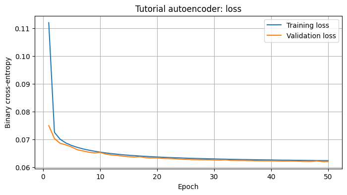
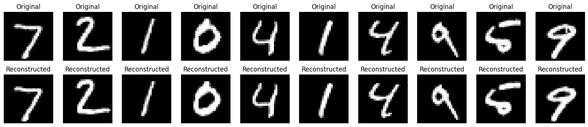
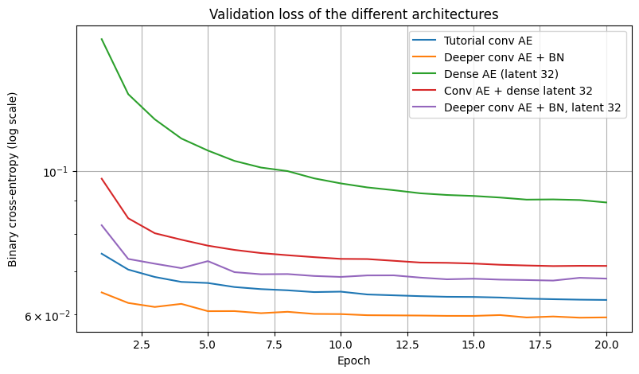
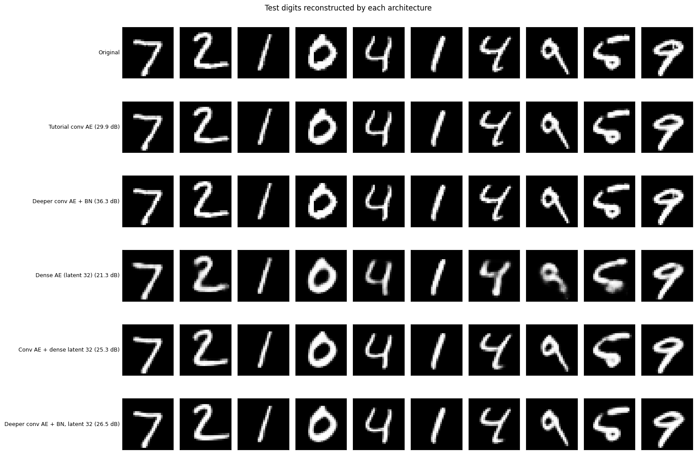
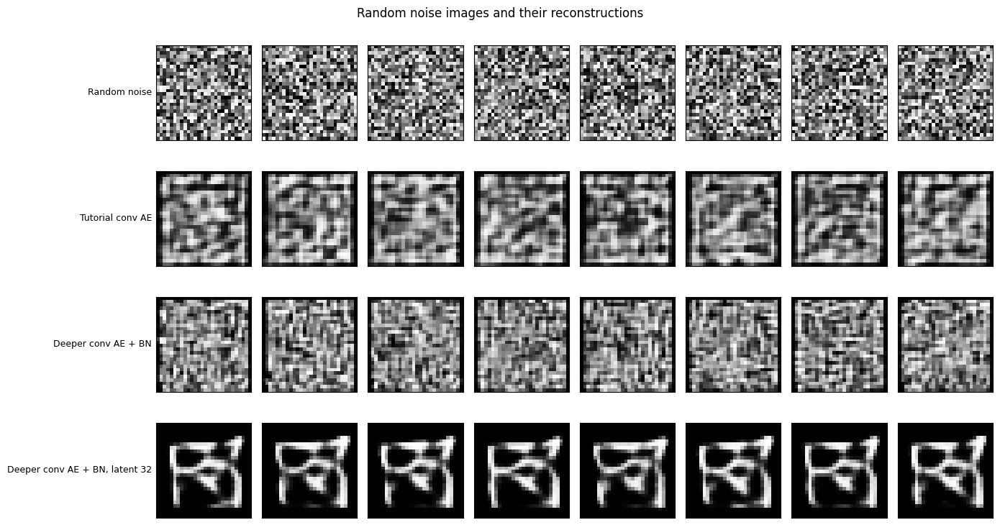
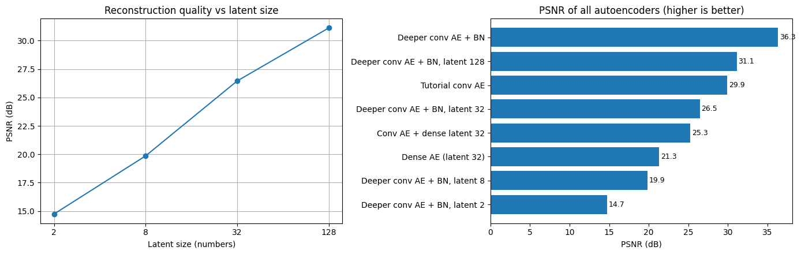
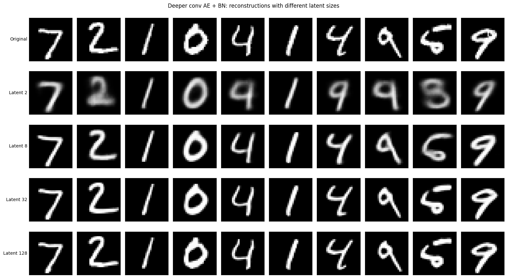

# Tutorial 12 – Basic Autoencoders

## Objective
Understand the architecture of basic autoencoders, implement one, and visualize its results.

An **autoencoder** is a neural network trained to output its own input. It has two parts:
- the **encoder** compresses the input into a smaller representation, called the **latent space**;
- the **decoder** reconstructs the original input from this latent representation.

Because the latent representation is smaller than the input, the network has to learn the most important features of the data to rebuild it. No labels are needed: the image is both the input and the target. Autoencoders are used for compression, removing noise from images, finding unusual data (anomaly detection) and learning features.

The tutorial was given in TensorFlow/Keras and has been implemented here in **PyTorch**.

## Files
| File | Description |
|---|---|
| `Tutorial_12.py` | Complete code, split into numbered blocks |
| `Tutorial_12_Colab.ipynb` | The same code as a Colab notebook, with outputs |
| `*.png` | Output plots |

## Tutorial Steps
**Data:** the MNIST handwritten digits (60,000 training and 10,000 test images of 28×28 pixels), normalized to [0, 1], with a channel dimension added (PyTorch puts the channel first: N×1×28×28).

**Autoencoder:** the same layers as the tutorial, with **74,497 parameters**:
- **Encoder:** Conv 32 → MaxPool (28×28 → 14×14) → Conv 64 → MaxPool (14×14 → 7×7).
- **Decoder:** Conv 64 → UpSample (7×7 → 14×14) → Conv 32 → UpSample (14×14 → 28×28) → Conv 1 with a sigmoid, giving a 28×28 image with values between 0 and 1.

**Training:** Adam (learning rate 0.001) and binary cross-entropy loss, 50 epochs, batch size 128, with the test images as validation data (146 s on a T4 GPU).

| Test loss (BCE) | MSE | PSNR |
|---|---|---|
| 0.0620 | 0.00089 | 31.14 dB |

The loss fell quickly in the first few epochs and then improved only slowly. Training and validation loss stayed together, so the model did not overfit. The reconstructed digits are almost identical to the originals. **PSNR** (peak signal-to-noise ratio) measures how close a reconstruction is to the original: higher is better, and every 10 dB means 10 times less error.

**Note:** the tutorial's text says the encoder ends with a dense layer that creates the latent space, but its code does not have one. The encoded image is therefore 64×7×7 = **3,136 numbers**, four times more than the 784 pixels of the input, so this model does not actually compress the image.

## Task – Improve the model
Five architectures were trained for 20 epochs each with the same settings:

| Model | Latent size | Compression | Parameters | BCE | MSE | PSNR (dB) | Time (s) |
|---|---|---|---|---|---|---|---|
| Tutorial conv AE | 3,136 | 0.25× (none) | 74,497 | 0.0632 | 0.00118 | 29.89 | 60 |
| **Deeper conv AE + BN** | 3,136 | 0.25× (none) | 167,233 | **0.0594** | **0.00027** | **36.34** | 176 |
| Dense AE | 32 | 24.5× | 476,720 | 0.0894 | 0.00920 | 21.29 | 23 |
| Conv AE + dense latent | 32 | 24.5× | 245,921 | 0.0713 | 0.00363 | 25.26 | 55 |
| Deeper conv AE + BN, latent 32 | 32 | 24.5× | 371,105 | 0.0682 | 0.00276 | 26.46 | 178 |

*Compression = 784 pixels / latent size. The deeper models use two convolutions per level, batch normalization (BN) and transposed convolutions for upsampling.*

- **More layers and batch normalization improved the reconstructions a lot.** With the same latent size and the same 20 epochs, the deeper model reached **36.34 dB**, against 29.89 dB for the tutorial's model. Its error (MSE) is **4.4 times smaller**, and it even beat the tutorial's model trained for 50 epochs (31.14 dB). Batch normalization also made it learn faster: its loss after 1 epoch was lower than the tutorial model's after 5.
- **Convolutional layers are much better than dense layers for images.** With the same latent size of 32, the convolutional autoencoder (25.26 dB) beat the dense one (21.29 dB) with half the parameters. The dense autoencoder's digits are blurry, because it treats the image as a flat list of pixels and cannot use the fact that neighbouring pixels belong together. The deeper convolutional model with batch normalization was best among the compressing models (26.46 dB).
- **A real bottleneck costs some quality.** Compressing each digit to 32 numbers (24.5 times smaller) gives lower scores than the models without compression, but the digits are still clearly readable.

### Does the model really compress?
Random noise images were given to three of the models:

| Model | MSE on digits | MSE on noise |
|---|---|---|
| Tutorial conv AE | 0.00118 | 0.11648 |
| Deeper conv AE + BN | 0.00027 | 0.08737 |
| Deeper conv AE + BN, latent 32 | 0.00276 | 0.27721 |

The two models without a bottleneck returned blurry, noise-like copies of the random input: their latent space is larger than the image, so they can partly copy things they have never seen. The model with a 32-number bottleneck turned **every noise image into the same digit-like shape**, because it can only produce the kind of images it learned. This shows that only a real bottleneck forces the autoencoder to learn what digits look like, which is what makes autoencoders useful for compression and anomaly detection.

### Effect of the latent size
The deeper model with a dense bottleneck was trained with four latent sizes:

| Latent size | Compression | MSE | PSNR (dB) |
|---|---|---|---|
| 2 | 392× | 0.03953 | 14.75 |
| 8 | 98× | 0.01327 | 19.86 |
| 32 | 24× | 0.00276 | 26.46 |
| 128 | 6× | 0.00089 | **31.12** |

- With **2 numbers**, the digits are blurry and some are confused with similar digits (a 4 becomes a 9 and a 5 becomes an 8).
- With **8 numbers**, the digits are readable but lose details.
- With **32 and 128 numbers**, the reconstructions are sharp. With 128 numbers, the model matches the tutorial model trained for 50 epochs (31.12 vs 31.14 dB) while compressing every image **6 times**.

The latent size is a trade-off: the smaller it is, the more the images are compressed, but the more detail is lost.

## How to Run
In Google Colab, select **Runtime → Change runtime type → T4 GPU**, upload `Tutorial_12_Colab.ipynb` (File → Upload notebook) and run all cells. MNIST is downloaded automatically.

## Requirements
Python 3, PyTorch, torchvision, NumPy, Matplotlib (all preinstalled in Google Colab)

## Output

### Tutorial autoencoder – loss

### Tutorial autoencoder – original and reconstructed digits

### Task – Validation loss of the different architectures

### Task – Test digits reconstructed by each architecture

### Task – Random noise and its reconstructions

### Task – Reconstruction quality vs latent size, and PSNR of all models

### Task – Reconstructions with different latent sizes

