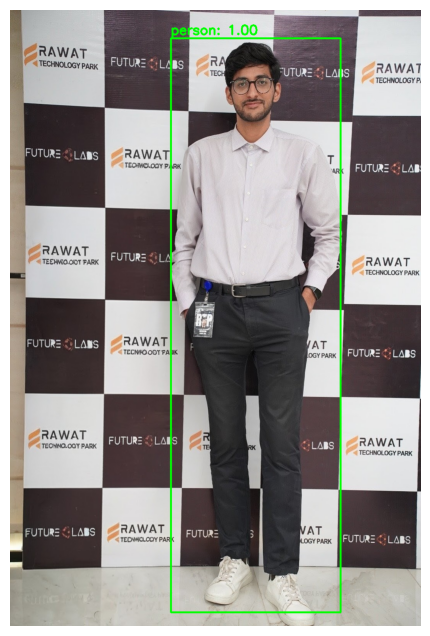
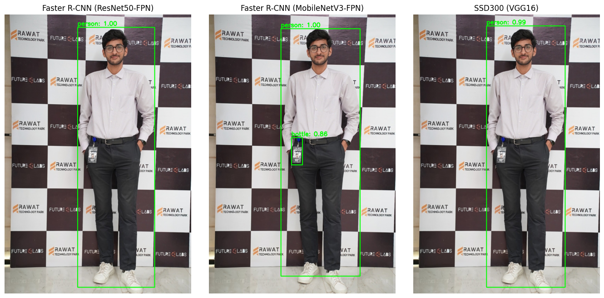
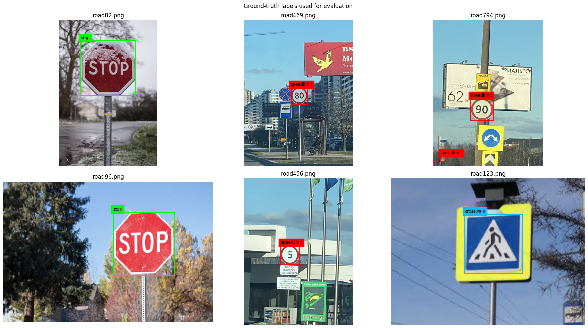
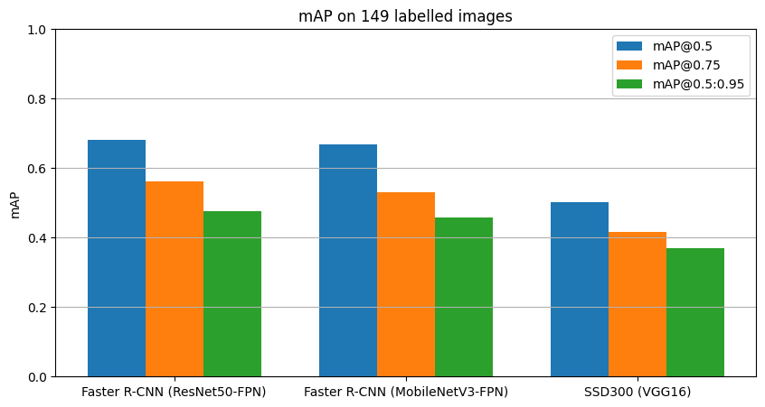
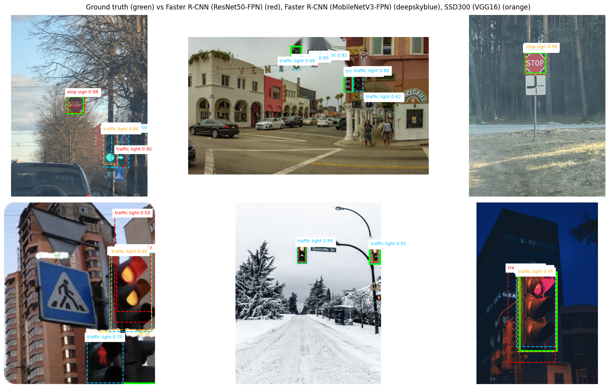

# Tutorial 8 – Object Detection using a Pretrained Faster R-CNN

## Objective
Use a Faster R-CNN that has already been trained on the COCO dataset (80 everyday object classes) to detect objects in new images without any training, draw the detected bounding boxes with their labels and confidence scores, compare detectors with different backbones, and evaluate them using mean Average Precision (mAP).

The tutorial loads its model from TensorFlow Hub. Here it is implemented in **PyTorch**, using the equivalent Faster R-CNN with a ResNet50 backbone from `torchvision`, also pretrained on COCO. The `detect_objects` and `display_image_with_detections` functions follow the tutorial's steps, with one difference: TensorFlow Hub returns normalized `[ymin, xmin, ymax, xmax]` boxes, while torchvision returns `[xmin, ymin, xmax, ymax]` in pixels.

The class names come from the model's own label list, which is indexed by COCO category id. The tutorial's approach of subtracting 1 from the class id and looking it up in an 80-name list only works for the first 11 classes, because COCO ids have gaps (for example, "stop sign" has id 13, not 12).

## Files
| File | Description |
|---|---|
| `Tutorial_8.py` | Complete code, split into numbered blocks |
| `Tutorial_8_Colab.ipynb` | The same code as a Colab notebook, with outputs |
| `*.png` | Output images and plots |

## Task 1 – Test with your own image
A photo of a person was passed through the pretrained Faster R-CNN (ResNet50-FPN). It found one object, **person (1.00)**, with a box covering the whole body.

## Task 2 – Two more models with different backbones
The ResNet50 Faster R-CNN was compared with a Faster R-CNN using a lightweight **MobileNetV3** backbone and an **SSD300** detector using a **VGG16** backbone, all pretrained on COCO, on the same photo.

| Model | Parameters | Detections (score ≥ 0.5) | Time (ms) |
|---|---|---|---|
| Faster R-CNN (ResNet50-FPN) | 41,755,286 | person 1.00 | 126.7 |
| Faster R-CNN (MobileNetV3-FPN) | 19,386,354 | person 1.00, bottle 0.86 | 26.3 |
| SSD300 (VGG16) | 35,641,826 | person 0.99 | 45.2 |

All three models found the person with near-certain confidence. MobileNetV3 was about 5 times faster than ResNet50 with half the parameters, but it also made a mistake: it labelled the ID card hanging on the person's lanyard as a "bottle". Its lighter backbone extracts less detailed features, which makes this kind of confusion more likely. SSD300 is a single-stage detector that resizes the image to 300×300, so it is faster than the two-stage ResNet50 Faster R-CNN.

## Task 3 – mAP on a set of evaluation data
**Evaluation data:** 150 road sign images, with their labelled boxes drawn on the images in one colour per class. The code reads the box coordinates back from these colours and then paints the drawings out (inpainting), so the detectors are tested on clean pictures. 149 images were used (1 had no labels), containing 193 objects: speedlimit (123), crosswalk (34), trafficlight (19) and stop (17).

The pretrained models only know the 80 COCO classes, so the labels were matched to them: "trafficlight" → traffic light and "stop" → stop sign. Speed limit signs and crosswalk signs are not COCO classes, so these 157 objects were left out, leaving **36 objects** for evaluation. Only detections of the two evaluated classes were counted.

| Model | mAP@0.5 | mAP@0.75 | mAP@0.5:0.95 | Precision | Recall | ms/image |
|---|---|---|---|---|---|---|
| **Faster R-CNN (ResNet50-FPN)** | **0.681** | **0.562** | **0.476** | 0.221 | 0.750 | 108.3 |
| Faster R-CNN (MobileNetV3-FPN) | 0.669 | 0.530 | 0.458 | 0.225 | 0.750 | 22.7 |
| SSD300 (VGG16) | 0.502 | 0.418 | 0.370 | 0.475 | 0.528 | 37.3 |

| AP@0.5 per class | ResNet50-FPN | MobileNetV3-FPN | SSD300 |
|---|---|---|---|
| traffic light | 0.555 | **0.617** | 0.339 |
| stop sign | **0.808** | 0.720 | 0.665 |

*Precision and recall use detections with a score of at least 0.5 and an IoU of at least 0.5 with a labelled box.*

- **ResNet50 Faster R-CNN was the most accurate** at every IoU threshold. **MobileNetV3 came very close** (0.669 vs 0.681 mAP@0.5) while being almost 5 times faster, so it gives the best balance of speed and accuracy.
- **SSD300 was the weakest**, especially on traffic lights (AP 0.339). Resizing every image to 300×300 makes small, distant traffic lights only a few pixels wide, so many were missed (recall 0.528).
- **Stop signs were easier than traffic lights** for all models: they are large, red and have a unique shape, while traffic lights are small and often seen from the side.
- **The low precision of the Faster R-CNN models (0.22)** does not mean most of their detections are wrong. The dataset only labels the main signs, so real traffic lights in the background, such as pedestrian lights and lights further down the street, have no label and count as false positives. This can be seen in the predictions figure. SSD300's higher precision comes from detecting fewer objects overall, at the cost of lower recall.
- **mAP drops from 0.68 at IoU 0.5 to 0.48 averaged over 0.5–0.95**, so the boxes are placed correctly but are not always tight. Part of this comes from the evaluation boxes themselves, which were read back from lines drawn on the images.
- With only 36 evaluated objects, these results are a rough comparison rather than a precise benchmark.

## How to Run
In Google Colab, select **Runtime → Change runtime type → T4 GPU**, upload `Tutorial_8_Colab.ipynb` (File → Upload notebook) and run the cells in order. Block 5 asks for an image, and Block 7 asks for the zip of labelled images (images with the boxes drawn on them, or images with Pascal VOC `.xml` / YOLO `.txt` label files).

## Requirements
Python 3, PyTorch, torchvision, OpenCV, NumPy, Matplotlib, Pillow, PyYAML (all preinstalled in Google Colab)

## Output

### Task 1 – Detection on your own image

### Task 2 – ResNet50 vs MobileNetV3 vs SSD300

### Task 3 – Evaluation data (ground-truth labels)

### Task 3 – mAP of the three models

### Task 3 – Ground truth vs predictions

