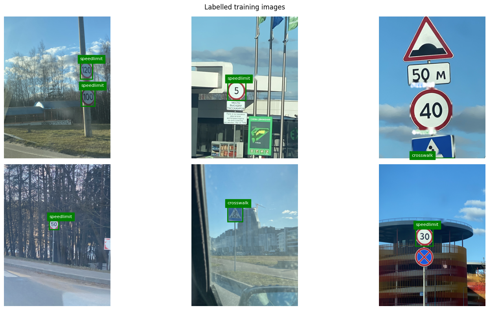
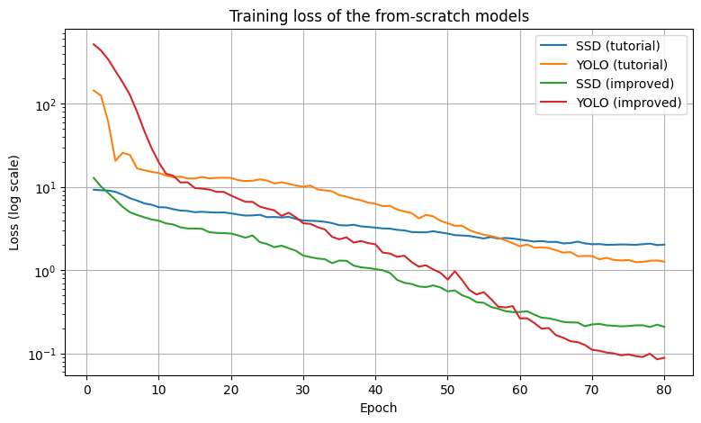
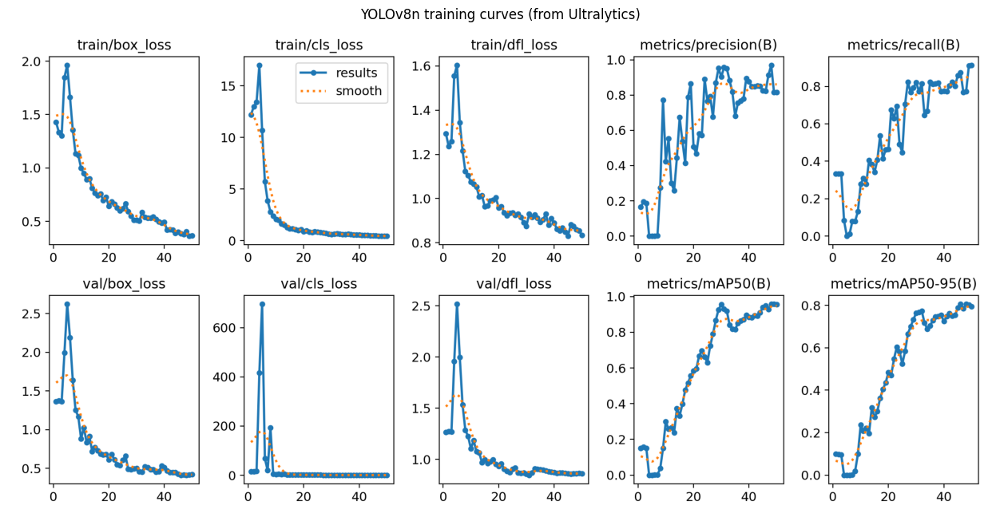
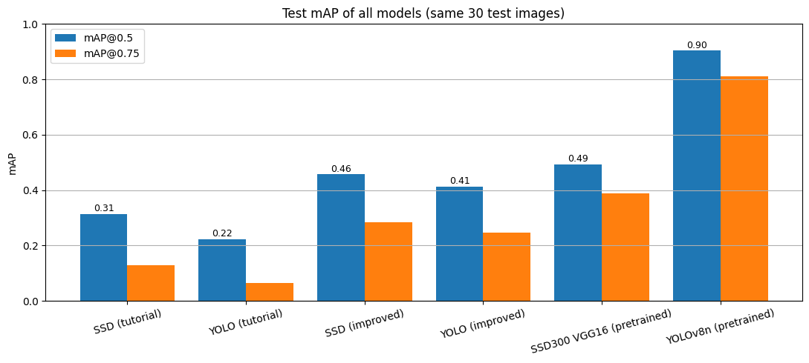
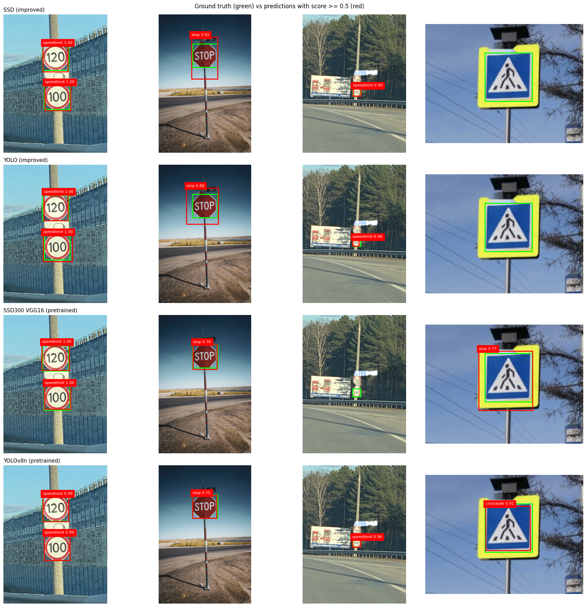

# Tutorial 9 – Object Detection using SSD & YOLO

## Objective
Understand the backbones, detection heads and prediction layers of the two main single-stage object detectors, SSD (Single Shot MultiBox Detector) and YOLO (You Only Look Once), implement both from scratch, and compare them with pretrained versions on a self-labelled dataset.

- **SSD** attaches prediction heads to feature maps of several sizes. Each cell of each map predicts 6 boxes with different aspect ratios (anchor boxes), so large feature maps find small objects and small feature maps find large ones.
- **YOLO** divides the image into an S×S grid. Each grid cell predicts a few boxes, each with 4 coordinates, 1 confidence score and one probability per class.

The tutorial was given in TensorFlow/Keras and has been implemented here in **PyTorch**.

## Files
| File | Description |
|---|---|
| `Tutorial_9.py` | Complete code, split into numbered blocks |
| `Tutorial_9_Colab.ipynb` | The same code as a Colab notebook, with outputs |
| `*.png` | Output plots |

## Tutorial Steps
**SSD (Blocks 2–5):** a 3-layer backbone turns a 300×300 image into a 75×75×128 feature map. Prediction heads are attached at 3 scales (75×75, 38×38 and 19×19), with a stride-2 convolution between them. With 6 boxes per cell, the model predicts **44,580 boxes**, giving outputs of shape **(1, 44580, 21)** for the classes and **(1, 44580, 4)** for the boxes, the same as the Keras version. The model has 907,266 parameters.

**YOLO (Blocks 6–9):** a 5-layer backbone turns a 416×416 image into a 13×13×512 feature map. A 1×1 convolution predicts 3 boxes per grid cell, giving an output of shape **(1, 13, 13, 3, 25)**: 4 coordinates + 1 confidence + 20 class scores (Pascal VOC) for each of the 507 boxes. The model has 1,607,051 parameters.

## Dataset
Both tasks use the same 150 road sign images as Tutorial 8, with the boxes read back from the colours drawn on the images. 149 images were used, containing 193 objects in four classes, split in the **same way as Tutorial 8**: 119 images for training and 30 for testing.

| Class | Train objects | Test objects |
|---|---|---|
| crosswalk | 26 | 8 |
| speedlimit | 101 | 22 |
| stop | 13 | 4 |
| trafficlight | 16 | 3 |

All six models were tested on the same 30 images with the same IoU, AP and mAP functions, so their results can be compared directly with each other and with Tutorial 8.

## Results

| Model | Parameters | mAP@0.5 | mAP@0.75 | Train time (s) |
|---|---|---|---|---|
| SSD (tutorial, from scratch) | 575,202 | 0.314 | 0.130 | 70.5 |
| YOLO (tutorial, from scratch) | 1,582,427 | 0.222 | 0.064 | 107.6 |
| SSD (improved, from scratch) | 970,744 | 0.457 | 0.283 | 104.7 |
| YOLO (improved, from scratch) | 3,306,427 | 0.413 | 0.246 | 163.0 |
| SSD300 VGG16 (pretrained) | 24,146,894 | 0.493 | 0.389 | 193.7 |
| **YOLOv8n (pretrained)** | 3,138,732 | **0.904** | **0.812** | 116.3 |

| AP@0.5 per class | crosswalk | speedlimit | stop | trafficlight |
|---|---|---|---|---|
| SSD (tutorial) | 0.183 | 0.779 | 0.292 | 0.002 |
| YOLO (tutorial) | 0.000 | 0.557 | 0.333 | 0.000 |
| SSD (improved) | 0.450 | 0.877 | 0.500 | 0.000 |
| YOLO (improved) | 0.262 | 0.889 | 0.500 | 0.000 |
| SSD300 VGG16 (pretrained) | 0.527 | 0.909 | 0.185 | 0.351 |
| YOLOv8n (pretrained) | **0.901** | **0.964** | **0.750** | **1.000** |

## Task 1 – Test the models on the labelled data, and improve them
The tutorial's models only produce raw outputs, so the parts needed for training were added:
- **SSD:** anchor boxes at 5 aspect ratios plus one extra square box per cell; matching of anchors to labelled boxes (IoU ≥ 0.5); a loss made of smooth L1 for the boxes and cross-entropy for the classes with hard negative mining; and non-maximum suppression for the final detections.
- **YOLO:** 3 anchor sizes found by k-means clustering of the training boxes (6%, 12% and 21% of the image width); assignment of each object to the grid cell containing its centre; a loss for box position, size, confidence and class; and non-maximum suppression.

All four from-scratch models were trained for 80 epochs. The tutorial's models were then improved:
- **Improved SSD (adding layers):** batch normalization, 2 extra convolution layers in the backbone, ReLU after the downsampling layers, and a 4th prediction scale (10×10) for large signs.
- **Improved YOLO (adding and removing layers, Darknet style):** batch normalization and LeakyReLU, extra 1×1 and 3×3 convolution layers, and the last max-pooling layer removed, so the grid is 26×26 instead of 13×13.

**Findings:**
- **The tutorial's models underfit.** Their training loss stopped falling at about 2.0 (SSD) and 1.3 (YOLO), and they reached only 0.314 and 0.222 mAP@0.5. In the tutorial's SSD, the downsampling layers have no activation function, so the 2nd and 3rd scales are only linear transformations of the first feature map and cannot learn new features.
- **The changes improved both models a lot:** SSD from 0.314 to **0.457** mAP@0.5 (+46%) and YOLO from 0.222 to **0.413** (+86%). Batch normalization made training faster and more stable, and the extra layers let the models learn more complex features.
- **The improved models overfit.** Their training loss fell almost to zero (0.21 for SSD and 0.09 for YOLO), while their test mAP stayed below 0.5. With only 119 training images, they memorized the training set instead of learning general features.
- **Speed limit signs were learned well** (AP up to 0.889), because they have 101 training examples. **No from-scratch model detected a single traffic light**, because there were only 16 small examples to learn from.
- **mAP@0.75 is much lower than mAP@0.5** for all from-scratch models, so their boxes are in roughly the right place but not tight.

## Task 2 – Train and test one pretrained SSD and one pretrained YOLO
- **SSD300 (VGG16 backbone)** from `torchvision`, pretrained on COCO, was given a new classification head for the four classes and trained for 40 epochs.
- **YOLOv8n** from Ultralytics, pretrained on COCO, was trained for 50 epochs on the same images written in YOLO format.

**Findings:**
- **YOLOv8n was by far the best model**, with **mAP@0.5 = 0.904** and mAP@0.75 = 0.812. It was the only model that detected every class well, including traffic lights. It also has fewer parameters than the improved YOLO from scratch and trained in under 2 minutes. Its strength comes from its COCO pretraining, a modern anchor-free design, larger 640×640 input images, and strong built-in data augmentation (such as mosaic, which combines 4 training images into 1).
- **The pretrained SSD300 (0.493) was only slightly better than the improved SSD from scratch (0.457)**, even with 25 times more parameters. Its new classification head starts from random weights, so 119 images were not enough to train it well. It confused crosswalk signs with stop signs (stop AP 0.185), and its 300×300 input makes small signs hard to see.
- **Pretraining matters more than the architecture.** The pretrained YOLOv8n is twice as accurate as the best from-scratch model.
- Ultralytics' own validation reported mAP50 = 0.937 and mAP50-95 = 0.779 for YOLOv8n. These are slightly different from the 0.904 above, because Ultralytics calculates AP in a slightly different way. The 0.904 uses the same functions as all the other models.

## Comparison with Tutorial 8
On the same 30 test images, the Faster R-CNN from Tutorial 8 reached mAP@0.5 = 0.806 and mAP@0.75 = 0.715. **YOLOv8n beat it on both (0.904 and 0.812)**, with about 13 times fewer parameters (3.1 million vs about 41 million). The single-stage YOLOv8n is both faster and, on this dataset, more accurate than the two-stage Faster R-CNN.

With only 37 test objects (and just 3 traffic lights and 4 stop signs), one missed sign changes a class's AP a lot, so small differences between models should not be over-interpreted.

## How to Run
In Google Colab, select **Runtime → Change runtime type → T4 GPU**, upload `Tutorial_9_Colab.ipynb` (File → Upload notebook) and run the cells in order. Block 11 asks for the zip of labelled images (images with the boxes drawn on them, or images with Pascal VOC `.xml` / YOLO `.txt` label files). Block 20 installs the `ultralytics` package.

## Requirements
Python 3, PyTorch, torchvision, Ultralytics, OpenCV, NumPy, Matplotlib, Pillow, PyYAML (all preinstalled in Google Colab except Ultralytics, which the notebook installs)

## Output

### Labelled training images

### Task 1 – Training loss of the from-scratch models

### Task 2 – YOLOv8n training curves

### Test mAP of all models

### Test images: ground truth (green) vs predictions (red)

